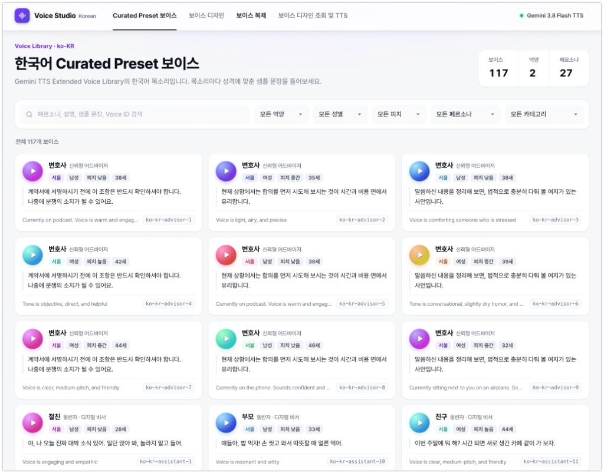

# 한국어 보이스 스튜디오 (Gemini 3.8 Flash TTS)

Gemini 3.8 Flash TTS로 한국어 목소리를 **둘러보고(Curated Preset) · 디자인하고 · 복제하고 · TTS로 들어보는** 웹앱입니다.
FastAPI 백엔드와 Vanilla JS 프론트엔드를 **같은 포트**에서 서빙합니다.



## 기능 (탭)

| 탭 | 기능 |
|---|---|
| **Curated Preset 보이스** | ko-KR Extended Voice Library **117개**. 페르소나 · 억양 · 성별 · 피치 · 카테고리 필터. 미리 생성한 샘플을 GCS에서 **재생만** 함 |
| **보이스 디자인** | ① 목소리 설명 프롬프트(`voices.create`, `VOICE_TYPE_PROMPTED`) → ② ①의 상황 · 사투리에 맞게 자동 생성된 발화로 바로 TTS. 진행 단계 표시 |
| **보이스 복제** | 동의 체크 → 한국어 동의문 녹음 → 샘플 문단 따라 읽기(10~30초) → `VOICE_TYPE_REPLICATED` |
| **보이스 디자인 조회 및 TTS** | 프로젝트에 저장된 목소리 목록(`voices.list`) → 목소리 선택 → 문장 · 오디오 태그(35종) · 스타일로 TTS |

- 녹음 원본, 디자인 샘플, TTS 결과는 **서버에 저장하지 않습니다**. GCS는 Curated Preset 미리듣기를 **읽기만** 합니다.
- 생성한 목소리는 **Google Cloud 프로젝트의 Voices API 리소스**로 저장됩니다(`store=True`). **마지막 사용 후 1년간 유지**되고, 사용할 때마다 만료일이 연장됩니다. 프로젝트별 저장 개수 한도가 있습니다.

### 보이스 디자인의 두 단계

| 단계 | API | 입력 |
|---|---|---|
| ① 목소리 만들기 | `client.voices.create(store=True, voice={"type": "VOICE_TYPE_PROMPTED", "prompted": {"input": ...}})` | 목소리 설명(나이 · 성별 · 역할 · 억양 · 톤 · 상황) |
| ② 발화 생성 | `client.models.generate_content(..., speech_config.voice_config.voice=<voice_id>)` | 읽을 문장 (+ 선택: `speech_metadata.style`, 오디오 태그) |

- ②의 기본 문장은 `POST /api/utterance`가 Gemini 텍스트 모델(`UTTERANCE_MODEL`, 기본 `gemini-2.5-flash`)로 ①에 맞춰 만듭니다.
- "Voice generation did not complete" 400 오류는 간헐적이며 목소리가 생성되지 않으므로 서버가 최대 3회 자동 재시도합니다.

## 로컬 실행

```bash
cp .env.example .env   # PROJECT_ID, GCS_BUCKET
gcloud auth application-default login
uv sync
uv run uvicorn app.main:app --port 8080
```

| 환경 변수 | 설명 |
|---|---|
| `PROJECT_ID` | Agent Platform(aiplatform) API가 켜진 프로젝트 |
| `GCS_BUCKET` | Curated Preset 미리듣기 음원 버킷 (비공개) |
| `LOCATION` | `global` (Voices API는 global) |
| `UTTERANCE_MODEL` | (선택) 발화 자동 생성 모델, 기본 `gemini-2.5-flash` |

## 데이터 / 스크립트

| 파일 | 설명 |
|---|---|
| `scripts/list_korean_library.py` | `voices.list`로 ko-KR 라이브러리 목소리 조회 → `data/korean_library_voices.json` (읽기 전용) |
| `scripts/pregenerate_previews.py` | 117개 미리듣기 TTS 생성 → `gs://$GCS_BUCKET/catalog/{id}.wav` (`--yes` 없으면 계획만 출력, 기존 파일 건너뜀) |
| `app/preview_texts.py` | 역할별 샘플 문장(부산 억양은 부산 사투리) + 목소리별 style |
| `data/preview_scripts.json` | 목소리별 실제 생성 문장 / 스타일 |
| `scripts/extract_catalog.py` | 한국어 카탈로그 HTML → `data/korean_voices.json` (프롬프트 템플릿 1,347개) |
| `scripts/translate_templates.py` | 템플릿 역할 · 설명 한국어화 (`role_ko`, `description_ko`, Gemini 텍스트 번역 · 캐시) |

> 한국어 카탈로그 HTML의 Voice ID는 API 라이브러리에 없어 TTS에 쓸 수 없으므로 **프롬프트 템플릿**(억양 · 성별 · 역할 · 설명 조합)으로만 사용합니다.

## Cloud Run 배포

> 아래 명령의 `PROJECT_ID`, `PROJECT_NUMBER`, `BUCKET_NAME`, `USER_EMAIL`은 실제 값으로 바꿔서 실행하세요.

### 1. 배포

```bash
gcloud run deploy korean-voice-studio --source=. \
  --region=us-central1 --project=PROJECT_ID \
  --iap --no-allow-unauthenticated \
  --set-env-vars=PROJECT_ID=PROJECT_ID,GCS_BUCKET=BUCKET_NAME,LOCATION=global \
  --memory=1Gi --timeout=300 --max-instances=3 --quiet
```

- 코드 수정 후에는 같은 명령으로 재배포합니다.
- `Dockerfile`은 `pyproject.toml` 기준으로 **공개 PyPI**에서 설치합니다. 로컬 `uv.lock`은 내부 미러 주소를 가리켜 Cloud Build에서 받을 수 없으므로 `.gcloudignore` / `.dockerignore`로 업로드에서 제외합니다.
- `--iap`를 켜면 IAP 서비스 에이전트(`service-<PROJECT_NUMBER>@gcp-sa-iap.iam.gserviceaccount.com`)에 서비스 `roles/run.invoker`가 자동 부여됩니다.

### 2. IAP 접근 허용 (사용자 추가)

```bash
gcloud iap web add-iam-policy-binding \
  --resource-type=cloud-run --service=korean-voice-studio --region=us-central1 \
  --member=user:USER_EMAIL \
  --role=roles/iap.httpsResourceAccessor \
  --project=PROJECT_ID --quiet
```

- 다른 사용자 · 그룹 · 도메인은 `--member=user:...` / `group:...` / `domain:...`로 추가합니다.
- 반영까지 1~2분 걸릴 수 있습니다. 여러 Google 계정에 로그인되어 있으면 허용된 계정으로 접속하세요.
- 현재 허용 목록 확인: `gcloud iap web get-iam-policy --resource-type=cloud-run --service=korean-voice-studio --region=us-central1 --project=PROJECT_ID`

### 3. 실행 서비스 계정 권한

현재 서비스는 **기본 compute 서비스 계정** `PROJECT_NUMBER-compute@developer.gserviceaccount.com`으로 실행됩니다.

| 앱 동작 | 필요한 권한 | 현재 부여 상태 |
|---|---|---|
| 미리듣기 목록 (`list_blobs`) | `storage.objects.list` | ✅ 프로젝트 수준 `roles/storage.objectViewer` (+ `roles/storage.admin`) |
| 미리듣기 음원 읽기 (`blob.open`) | `storage.objects.get` | ✅ 같은 권한 |
| Voices API · TTS · 발화 생성 | `aiplatform.*` | ✅ `roles/aiplatform.user` |

- 버킷 `gs://BUCKET_NAME`에는 별도 바인딩이 없고(기본 legacy 바인딩만) **프로젝트 수준 권한으로 접근**합니다.
- 배포 후 Cloud Run 로그에서 `GET /api/catalog`(목록) · `GET /api/catalog/{id}/preview`(읽기) · `GET /api/voices` 모두 200으로 확인했습니다.

> **운영 권장 (최소 권한):** 기본 compute SA는 `roles/editor`, `roles/storage.admin` 등 권한이 넓습니다. 앱 전용 서비스 계정을 만들고 아래 권한만 부여한 뒤 `--service-account`로 지정하세요. (IAM 변경이므로 관리자 승인 후 실행)
>
> ```bash
> gcloud iam service-accounts create voice-studio-run --project=PROJECT_ID
> gcloud projects add-iam-policy-binding PROJECT_ID \
>   --member=serviceAccount:voice-studio-run@PROJECT_ID.iam.gserviceaccount.com --role=roles/aiplatform.user
> gcloud storage buckets add-iam-policy-binding gs://BUCKET_NAME \
>   --member=serviceAccount:voice-studio-run@PROJECT_ID.iam.gserviceaccount.com --role=roles/storage.objectViewer
> # 이후 배포 명령에 --service-account=voice-studio-run@PROJECT_ID.iam.gserviceaccount.com 추가
> ```
